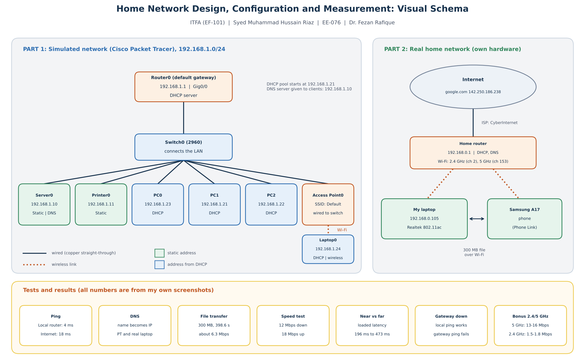
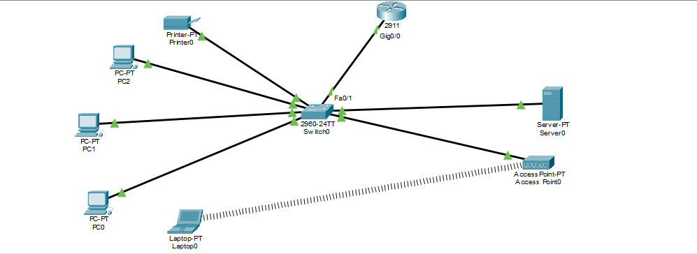

# Home Network Design, Configuration and Measurement

| | |
|---|---|
| **Name** | Syed Muhammad Hussain Riaz |
| **Roll number** | EE-076 |
| **Subject** | ITFA (course code EF-101) |
| **Instructor** | Dr. Fezan Rafique |
| **Submission** | Week 13, Monday 9 November 2026 |

This project designs, configures and investigates a small local-area network so that the physical and logical components that let devices communicate can be understood. It has two parts:

1. **A simulated network** built in Cisco Packet Tracer (running version included).
2. **Real measurements** taken on my own hardware: my laptop, my Samsung A17 phone and my home router.

## Repository contents

```
home-network-project/
├── README.md                  this page
├── packet-tracer/
│   └── networking_project.pkt   running version of the simulated network
├── screenshots/               31 screenshots (evidence for every task)
├── report/
│   └── Home_Network_Project_Report.pdf   short report (same file submitted on Google Classroom)
└── schema/
    └── visual_schema.png      visual schema of the project
```

## Visual schema



## Topology (Packet Tracer)



Solid lines are wired links (copper straight-through). The dotted line is the wireless link between Laptop0 and Access Point0.

## IP addressing table (Packet Tracer, 192.168.1.0/24)

| Device | IP address | Subnet mask | Default gateway | Assigned by |
|---|---|---|---|---|
| Router0 (Gig0/0) | 192.168.1.1 | 255.255.255.0 | not applicable | Static |
| Server0 (DNS) | 192.168.1.10 | 255.255.255.0 | 192.168.1.1 | Static |
| Printer0 | 192.168.1.11 | 255.255.255.0 | 192.168.1.1 | Static |
| PC1 | 192.168.1.21 | 255.255.255.0 | 192.168.1.1 | DHCP |
| PC2 | 192.168.1.22 | 255.255.255.0 | 192.168.1.1 | DHCP |
| PC0 | 192.168.1.23 | 255.255.255.0 | 192.168.1.1 | DHCP |
| Laptop0 (wireless) | 192.168.1.24 | 255.255.255.0 | 192.168.1.1 | DHCP |

The router is the DHCP server (pool starts at 192.168.1.21) and gives the DNS server address 192.168.1.10. DHCP addresses can change when the file is reopened, so the table shows the addresses from the final screenshots.

## How to run the simulation

1. Install Cisco Packet Tracer and open `packet-tracer/networking_project.pkt`.
2. Wait about 30 seconds until all link lights are green.
3. Click **PC0**, then **Desktop**, then **Command Prompt**, and try:
   - `ping 192.168.1.1` (router / default gateway)
   - `ping 192.168.1.10` (server)
   - `nslookup www.test.com` (should return 192.168.1.10)
4. Click **Laptop0**, then **Desktop**, then **Command Prompt**, and run `ping 192.168.1.10` to test the wireless link.

## Main results

| Test | Result |
|---|---|
| Ping, Packet Tracer (PC0) | Router 3 ms, server 1 ms, PC1 0 ms average, 0% loss |
| Ping, wireless Laptop0 to server | 24 ms average (11 to 45 ms) |
| Ping, real laptop | Home router 4 ms, google.com 18 ms average |
| DNS | `www.test.com` gives 192.168.1.10 (Packet Tracer); `google.com` gives 142.250.186.238 (real) |
| File transfer (real) | 300 MB in 398.64 s, about 6.3 Mbps, laptop to phone over Wi-Fi with Phone Link |
| Internet speed, near router (2.4 GHz) | 12 Mbps down, 18 Mbps up, 27 ms unloaded, 196 ms loaded |
| Internet speed, far room (2.4 GHz) | 9.8 Mbps down, 17 Mbps up, 26 ms unloaded, 473 ms loaded |
| Gateway shut down | Local ping to PC1 still works; ping to the router fails (100% loss) |
| 5 GHz (channel 153) | 13 to 16 Mbps down |
| 2.4 GHz (channel 2) | 1.5 to 1.8 Mbps down in this session (15 Mbps the night before) |

## Screenshot index

Every file is in the `screenshots` folder.

| Professor's task | Screenshots |
|---|---|
| Topology, wired and wireless links | `Topology`, `Wireless_Ping` |
| IP, subnet mask, default gateway, MAC (3 devices) | `Laptop_0_ipconfig`, `Printer_ip_mac`, `Printer_Gateway`, `real_laptop_ipconfig` |
| Manual or DHCP addressing | `PC_0_DHCP`, `PC_1_DHCP`, `PC_2_DHCP`, `Server_Static` |
| Ping and round-trip latency | `Ping_Packettracer`, `Ping_Real` |
| DNS | `DNS_Packettracer`, `DNS_Real` |
| Local file transfer and throughput | `File_Size`, `File_Transfer`, `Band_During_Transfer` |
| Internet speed test | `speedtest` |
| Near vs far wireless | `near_room_speedtest`, `far_room_speedtest` |
| Default gateway unavailable | `Gateway_Before`, `Router_Shutdown`, `Gateway_Down_Local`, `Gateway_Down_Fail`, `Gateway_After` |
| Bonus: 2.4 GHz vs 5 GHz | `Bssid_List`, `5ghz_Band_Proof`, `5ghz_Test_1`, `5ghz_Test_2`, `2.4ghz_Band_Proof`, `2.4ghz_Test_1`, `2.4ghz_Test_2` |

## Report

The short report is in [`report/Home_Network_Project_Report.pdf`](report/Home_Network_Project_Report.pdf). It covers the topology, addressing table, all measurements, the difference between a switch, router, access point and network interface card, the required analysis, safety and ethics, and the conclusion.

## Notes and limits

- Packet Tracer is a simulation, so its ping times (and the extra wireless delay) show the idea and not real-world values. The real tests are the real evidence.
- My Internet speed changed from test to test, and each near/far or band test was done only once or twice, so the results are only for these tests.
- The slow file transfer (about 6.3 Mbps) was much lower than the Wi-Fi link rate, so the limit was probably the phone or Phone Link. I did not test the phone separately.

## Safety and ethics

Only Packet Tracer and my own devices on my own home network were used. No university or other people's networks were tested.
